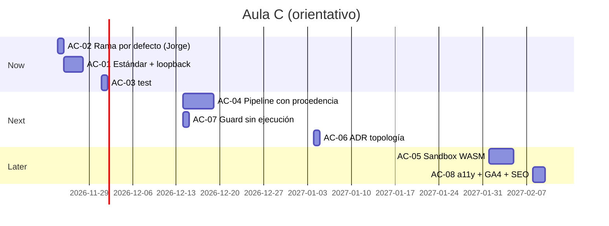

# INITIATIVES · Aula C
> **Versión pública redactada** (repo público). Los detalles explotables se sustituyeron por «detalle en projects-tools (privado)».

> **Cómo leer este documento.** Síntesis de la ronda de iniciativas del 23 nov 2026 (pedido de Jorge, t89u), consolidada por Grok Bot a partir de los aportes de The Office y de los Tech Leads (fuentes internas; detalle en projects-tools (privado)). Cada iniciativa cita sus **roles fuente** y los IDs originales para trazabilidad. Etiquetas: **[O]** observado en una fuente citada · **[H]** hipótesis por confirmar · **[EP]** evidencia pendiente. Esfuerzo: **S** ≤ ½ día · **M** 1–3 días · **L** 1–2 semanas · **XL** > 2 semanas. Prioridad: **P0** riesgo activo, va primero · **P1** este ciclo · **P2** siguiente · **P3** oportunista. Las fechas del roadmap son orientativas y no autorizan nada por sí solas.

- **Repo destino de este archivo:** `jorgedelacruz07/aula-c`. No hay workspace aparte.
  - ⚠️ La **rama por defecto en GitHub es `main`, 17 commits por detrás de `master`, y no contiene `api/`** (Architect, QE-AUL-02).
  - El PR de este archivo debe abrirse **contra `master`**, o primero resolver AC-02.
- **Producción:** web en `https://aula-c-jorge.web.app` (Firebase Spark) y API en Cloud Run, repartidas en **tres proyectos GCP**:
  - web + Auth;
  - documentos con facturación;
  - Gemini.
- **Qué es:** experimento docente: guía progresiva de C con laboratorio WebAssembly/WASI **en el navegador**, más administración docente de documentos privados con Gemini (borradores → publicación).
- **Sin Tech Lead.** Es el único proyecto con Cloud Run que no tiene `AGENTS.md`, `CLAUDE.md`, `doppler.yaml` ni `.claude`.
- **Fuentes:**
  - AppSec (SEC-AULAC-*), Platform (AULAC-PLAT-*), Quality (QE-AUL-*), Software Architect (ARCH-AULAC-*), Learning & Career Coach (LCC-AULA-*) y Content Strategist (TCS-AULA-*).
  - Product & UX: sus `AC-01..03` → **AC-UX-01..03**.
  - Los `AC-*` del Scout eran de AcademyDB y se renombraron `AIS-ADB-*`.
- **Resolución de conflicto:**
  - AULAC-PLAT-03 (Platform: aislar en Cloud Run la ejecución de código de alumnos, P1) **queda descartada como iniciativa de aislamiento** porque AppSec (SEC-AULAC-03) verificó que `api/server.mjs` no importa `child_process` ni usa `spawn`/`exec`, y que la compilación C→WASM ocurre fuera del servidor.
  - Se conserva solo como **guard condicional** (AC-07): si algún día aparece ejecución en el servidor, se reabre con P1.

## 1. Resumen ejecutivo

Aula C funciona pero está fuera del estándar del ecosistema:

- **No tiene `AGENTS.md` ni `doppler.yaml`.** La clave de Gemini se lee del entorno (**[EP]**; detalle en projects-tools (privado)).
- **El bind de la API en desarrollo no sigue el estándar de loopback** (detalle en projects-tools (privado)).
- **La rama por defecto está desactualizada**, así que revisores y MCP ven código viejo.
- **Las pruebas de los 83 ejercicios C no están en ningún gate.**
- **Hay un pipeline de contenido generado por IA** (documento → Gemini → borrador → publicación) sin modelo de estados documentado. Hoy el catálogo público está vacío, así que no hay exposición.

**Orden:**
1. Incorporar al estándar (AGENTS, Doppler/Secret Manager, loopback).
2. Rama por defecto.
3. `test:c` en el gate.
4. Antes de la primera publicación: pipeline con procedencia + sanitización.
5. Después: sandbox WASM, ADR de topología y accesibilidad.

## 2. Estado actual (con evidencia y fechas)

| Ámbito | Estado | Fuente |
|---|---|---|
| Repo | `master` limpio en `c68a8b0` (14 nov). `origin/HEAD = main` va 17 commits por detrás y **sin `api/`**. Ramas `probe-test-t3` y `test-verification`. | [O] AUD L60; Architect; QE-AUL-02 |
| Estándar | Sin `AGENTS.md`, `CLAUDE.md`, `doppler.yaml` ni `.claude`. | [O] AUD L166 |
| Puertos | Bind de dev fuera del estándar (detalle en projects-tools (privado)). | [O] AUD |
| Secretos | Configuración por variables de entorno; falta Doppler/Secret Manager (detalle en projects-tools (privado)). | SEC-AULAC-02 |
| Ejecución en el servidor | **No existe:** sin `child_process`/`spawn`/`exec` en `api/server.mjs`. Las rutas son de CMS. | [O] SEC-AULAC-03 |
| Contenido IA | Subir → Gemini → borrador → publicación pública (detalle en projects-tools (privado)). 8 fuentes y 6 PDF en borradores; **catálogo público vacío** (14 nov). | [O] SEC-AULAC-01; ARCH-AULAC-01 |
| Tests | 83 ejercicios C con soluciones; `test:c` fuera de cualquier gate. **[H]** No hay tests de límites del sandbox WASM. | [V] QE-AUL-01/03 |
| Web | 1 `INPUT` sin nombre accesible. Dos IDs de GA4 (`G-B57ERLBRGE`, `G-XN2LBG4FXE`) y sin banner. `robots.txt` y `sitemap.xml` → 404; sin OG ni canonical; el 404 real funciona bien. | [O] Product AC-UX-01..03 |
| Topología | 3 proyectos GCP, registrados como «adición» en `DEPLOYMENTS.md`, sin ADR. | [O] ARCH-AULAC-02 |
| Estructura | En la raíz conviven `Aula C.xcodeproj`, `MyTool/`, `Makefile`, `web/`, `api/`, `lecciones/`, `ejercicios/`, `pruebas/` y `herramientas/`. | [O] ARCH-AULAC-03 |

## 3. Iniciativas

### AC-01 · Incorporar Aula C al estándar: `AGENTS.md`, Doppler → Secret Manager, SA mínima y API en loopback — **P1 · S** (el bind es P0 dentro de TX-01)
- **Fuentes:** AULAC-PLAT-01; SEC-AULAC-02; LCC-AULA-01; TX-01, TX-05 y TX-12.
- **Propuesta:**
  - `AGENTS.md` < 8 KB que enlace a `DEPLOYMENTS.md`.
  - `doppler.yaml` base.
  - Secretos por Secret Manager (`--set-secrets`).
  - Service account con permisos mínimos (detalle en projects-tools (privado)).
  - Clave de Gemini restringida por API.
  - API en loopback en desarrollo (TX-01).
  - Entrada completa en el registry. `safetyProfile` **[H]**: si hay alumnos, podrían ser datos de estudiantes o de menores.
- **Aceptación:**
  - `AGENTS.md` y `doppler.yaml` presentes.
  - el check de loopback de TX-01 pasa.
  - `gcloud run services describe` muestra los secretos como referencias.
  - `project-agents doctor` pasa.
- **Plan para el agente:**
  1. Rama `chore/platform-standard` **desde `master`**.
  2. Inventario de las variables por nombre.
  3. Cambios y test del bind.
  4. PR contra `master`.
  - **OK de Jorge:** crear el proyecto en Doppler, cargar los secretos, el deploy con `--set-secrets` y la SA.

### AC-02 · Rama por defecto coherente y check de deriva de la rama por defecto — **P1 · S**
- **Fuentes:** QE-AUL-02; AULAC-PLAT-02; TX-28.
- **Propuesta:**
  - Jorge elige: cambiar la rama por defecto a `master` o hacer fast-forward de `main`.
  - Archivar `main` como tag si se abandona.
  - Revisar `probe-test-t3` y `test-verification`.
  - Check `default-branch-drift` en el meta-repo, contra la rama declarada en el registry.
- **Aceptación:** `gh repo view --json defaultBranchRef` → la rama de trabajo; el check da 0 repos con deriva.
- **OK de Jorge:** el cambio de configuración del repo (no lo hace un agente).

### AC-03 · Pruebas de C (`test:c`) en el gate — **P1 · S**
- **Fuentes:** QE-AUL-01; TX-11.
- **Propuesta:** `verify` incluye `test:c` con el toolchain fijado en `scripts/toolchain.json`, en el Mini.
- **Aceptación:** romper una solución hace fallar `verify`; los 83 ejercicios en verde.

### AC-04 · Pipeline de contenido IA con estados, procedencia y sanitización (antes de la primera publicación) — **P2 · M** (pasa a **P1 antes de publicar el primer material**)
- **Fuentes:** ARCH-AULAC-01; SEC-AULAC-01; LCC-AULA-02.
- **Propuesta:**
  - Máquina de estados `uploaded → draft → reviewed → published → retired`.
  - Cada ítem `published` exige `reviewer` y `source.hash`.
  - Sanitización del contenido generado antes de renderizar (detalle en projects-tools (privado)).
  - Revisión humana obligatoria documentada como control frente a prompt injection.
  - `retired` saca el ítem del catálogo sin borrarlo.
- **Aceptación:**
  - Un test de la API rechaza publicar sin `reviewer`/`source.hash`.
  - Los casos de contenido malicioso se neutralizan (detalle en projects-tools (privado)).
- **OK de Jorge** (y del docente responsable): cada publicación.

### AC-05 · Tests del sandbox WASM: tiempo, memoria y capacidades WASI — **P2 · M**
- **Fuentes:** QE-AUL-03; LCC-AULA-03 (accesibilidad del laboratorio).
- **Propuesta:** corpus hostil (bucle infinito, `malloc` masivo, lectura de `/etc`, recursión profunda). Exige un corte con error controlado y la denegación de WASI no concedido.
- **Aceptación:** los 4 casos terminan dentro del límite.

### AC-06 · ADR de topología: tres proyectos GCP y límite de coste — **P2 · S**
- **Fuentes:** ARCH-AULAC-02; TX-15.
- **Aceptación:** ADR aceptado, con presupuesto y alertas de facturación en el proyecto con facturación.
- **OK de Jorge:** el ADR y cualquier alerta de facturación.

### AC-07 · Guard «sin ejecución en el servidor» (AULAC-PLAT-03, condicional) — **P3 · S**
- **Fuentes:** SEC-AULAC-03; AULAC-PLAT-03 (**descartada como aislamiento**); LCC-AULA-03; TCS-AULA-02.
- **Propuesta:** test que falla si `api/` importa `child_process`, `vm` o `worker_threads` con código de usuario, o si añade una dependencia de compilación. **Si el test se tuviera que relajar**, se reabre AULAC-PLAT-03 con P1:
  - Cloud Run aislado;
  - timeout;
  - sin egress;
  - SA sin roles.
- **Aceptación:** el test está en `verify` y falla con un `import 'node:child_process'` plantado.

### AC-08 · Accesibilidad, medición con consentimiento y SEO básico — **P2/P3 · S**
- **Fuentes:** AC-UX-01 (= Product `AC-01`: input sin nombre y auditoría del editor por trampa de foco, WCAG 2.1.2); AC-UX-02 (= Product `AC-02`: un solo GA4 y consentimiento con el patrón de AcademyDB); AC-UX-03 (= Product `AC-03`: robots, sitemap y OG, si Jorge quiere que sea encontrable); TCS-AULA-01 (comprobar la política del curso antes de difundir [H]).
- **OK de Jorge:** GA4, indexación y difusión.

### AC-09 · Estructura del repo y README bilingüe — **P3 · S**
- **Fuentes:** ARCH-AULAC-03; TCS-AULA-03.
- **Propuesta:** mapa de carpetas en `AGENTS.md` con propietario y comando de validación por zona: currículo, web, API y herramientas nativas.
- **Dependencias:** AC-01 y AC-02.

## 4. Mapa de fuentes → iniciativa consolidada

| ID consolidado | IDs de origen |
|---|---|
| AC-01 | AULAC-PLAT-01, SEC-AULAC-02, LCC-AULA-01 |
| AC-02 | QE-AUL-02, AULAC-PLAT-02 |
| AC-03 | QE-AUL-01 |
| AC-04 | ARCH-AULAC-01, SEC-AULAC-01, LCC-AULA-02 |
| AC-05 | QE-AUL-03 |
| AC-06 | ARCH-AULAC-02 |
| AC-07 | SEC-AULAC-03, AULAC-PLAT-03 (descartada → condicional), LCC-AULA-03, TCS-AULA-02 |
| AC-08 | AC-UX-01, AC-UX-02, AC-UX-03, TCS-AULA-01 |
| AC-09 | ARCH-AULAC-03, TCS-AULA-03 |

## 5. Roadmap

| Ola | Ventana orientativa | Iniciativas |
|---|---|---|
| **Now** | 24 nov – 12 dic 2026 | AC-02 (decisión), AC-01, AC-03 |
| **Next** | 14 dic 2026 – 23 ene 2027 | AC-04 (antes de la primera publicación), AC-07, AC-06 |
| **Later** | feb – mar 2027 | AC-05, AC-08, AC-09 |

## 6. Decisiones abiertas para Jorge

1. **Rama por defecto:** cambiarla a `master` o hacer fast-forward de `main` (AC-02).
2. Proyecto Doppler, secretos en Secret Manager y SA mínima (AC-01); `safetyProfile` según haya o no alumnos reales.
3. Confirmar que **AULAC-PLAT-03 queda descartada** y solo se mantiene el guard condicional (AC-07).
4. Quién revisa y aprueba cada publicación de contenido generado (AC-04).
5. Objetivo del sitio: encontrable o no, un solo GA4 y consentimiento (AC-08). ¿Asignar un Tech Lead?

## Reglas fijas (aplican a cada paso de este documento)

1. **Solo el Mac Mini.** Todo se ejecuta y se cambia en el Mac Mini. El MacBook Air solo es puente SSH (detalle en projects-tools (privado)) y nunca se editan archivos en él.
2. **Ramas aisladas.** Una tarea = una rama o entorno aislado (según el contrato de aislamiento vigente, ver TX-13 en `_transversal`), con un solo escritor por repo. Nada de `--force`, `reset --hard`, reescritura de historial ni sobrescribir trabajo ajeno. Las lecturas de git usan `GIT_OPTIONAL_LOCKS=0`.
3. **Secretos solo en Doppler.** Nunca en archivos, commits, logs, prompts ni variables de Cloud Run en claro. Nunca se imprime un valor (`doppler secrets --only-names`, o `| shasum` si hay que comparar).
4. **Nunca leer `.env`** (ni `auth`, `config.yaml`, `state.db`, sesiones o memorias). Si un `.env` está versionado, se trata por nombre y metadatos (tamaño, commit), sin abrirlo.
5. **Destinos de despliegue:** frontends en **Firebase Hosting**, backends en **Cloud Run**. **Nunca Vercel.** Excepciones documentadas: RutinAI en el NAS; IdeaDesk, ProjectsDocs y Switchboard en el Mini.
6. **Sin OK explícito de Jorge no hay:** deploy, migración de datos, cambio de IAM/GCP/Doppler `prd`, Funnel de Tailscale, instalación, borrado de ramas/stashes, publicación o mensaje externo. Merge: solo PRs validados (QA o revisión de otro proveedor sobre el **mismo SHA**, sin conflictos), según la autorización de Jorge del 23 nov; lo demás lo decide Jorge.
7. **Quien implementa no verifica.** La revisión la hace un proveedor distinto del implementador; el veredicto vale solo para el SHA revisado.
8. **Paso 0 siempre de solo lectura:** la evidencia de este documento tiene fecha; antes de cambiar nada se reverifica. Lo que ya no aplique se marca como resuelto y no se ejecuta.
9. **Si `gh` devuelve 401, se informa y no se reintenta.** No se buscan rutas alternativas para credenciales.
